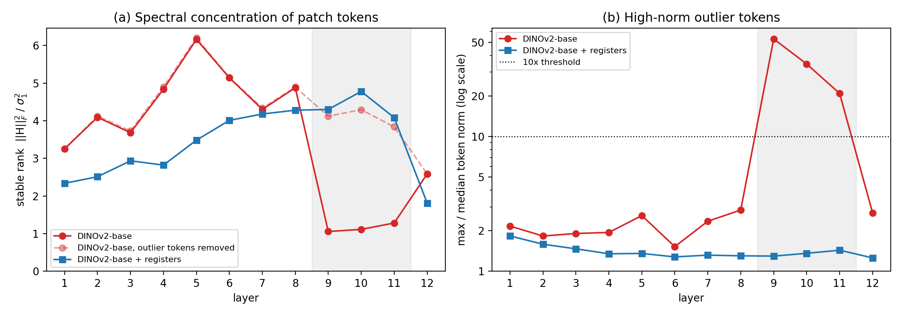

# asro-pilot
Pilot experiments for my MSCA Postdoctoral Fellowship 2027 proposal
(working title: ASRO – knowing when to correct spectral concentration in transformers).

## Question
Do the top singular directions of transformer token representations help, hurt,
or do nothing for the loss – and does this differ by layer?

## Status
- [x] v0: top-8 singular values per layer, DINOv2-base, 32 Imagenette val images
- [x] v0 diagnosis: outlier-token analysis + DINOv2-with-registers control
- [ ] v1: exact loss change when damping each top-8 direction (~500 images)
- [ ] v2: pathology model on Camelyon17-WILDS
- [ ] v3: Pythia-160M / 410M

## First result

- Layers 9–11 of DINOv2-base collapse to stable rank ≈ 1. This is caused by ~3 high-norm
  patch tokens per image (21–53× the median norm). Removing them, or using registers
  (Darcet et al., ICLR 2024), restores stable rank ≈ 4.
- Final-layer concentration persists even with registers (stable rank 1.81).
- So concentration has at least two distinct mechanisms at different depths.

## All figures and data
Captions for every figure: [results/figure_captions.md](results/figure_captions.md)

| Figure | File | What it shows |
| --- | --- | --- |
| Figure 1 | [fig_prelim_concentration.png](results/asro_results/fig_prelim_concentration.png) | Stable rank and outlier tokens, DINOv2-base vs registers (proposal version) |
| Figure S1 | [pilot_v0.png](results/asro_results/pilot_v0.png) | First pilot: top-8 singular values and top-1 energy share per layer |
| Figure S2 | [pilot_v0_registers_comparison.png](results/asro_results/pilot_v0_registers_comparison.png) | Draft of Figure 1 (same data) |
| Figure S3 | [sample_images.png](results/asro_results/sample_images.png) | Example input images |

| Data file | Contents |
| --- | --- |
| [pilot_v0_mean_singular_values.csv](results/asro_results/pilot_v0_mean_singular_values.csv) | Mean sigma_i / ||H||_F, 12 layers x top-8 |
| [pilot_v0_results.json](results/asro_results/pilot_v0_results.json) | Top-1 energy share and stable rank per layer |
| [pilot_v0_diagnostics.csv](results/asro_results/pilot_v0_diagnostics.csv) | Token-norm ratios and stable rank (raw, centred, no CLS, no outliers) per layer |
| [pilot_v0_registers_control.csv](results/asro_results/pilot_v0_registers_control.csv) | Same diagnostics for DINOv2-with-registers |

## How to run
Open `notebooks/asro_pilot_v0.ipynb` in Google Colab (Runtime → T4 GPU) and run the cells in order:
Cells 1–5 = pilot v0, Cell 6 = randomised SVD study, Cell 7 = zip outputs,
Cell 8 = outlier-token diagnosis, Cell 9 = registers control, Cells 10 and 10b = Figure 1.
Seed = 0. See `requirements.txt`. Progress notes: [evidence_log.md](evidence_log.md).

## Author
Dr Savitha K N (Mathematics; ML,AL, Transformers, RNN,CNN,Linear Algebra, Spectral Analysis, optimisation)
