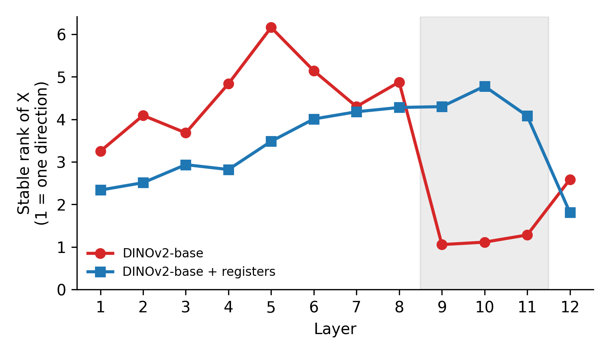

## Main pilot study
**Notebook:** [notebooks/asro_pilot_study.ipynb](notebooks/asro_pilot_study.ipynb) (Runtime -> Run all, about 25 minutes on a T4 GPU)
**Results:** [results/pilot_study/](results/pilot_study/) - all numbers in [pilot_summary.md](results/pilot_study/pilot_summary.md)

**Findings (DINOv2-base, with and without registers, 32 Imagenette images)**
1. Two causes of spectral concentration: a few high-norm outlier tokens (layers 9-11) and a direction shared by all tokens (final layer); registers remove only the first.
2. The dominant directions are mostly useful: removing them lowers accuracy from 100% to about 50%.
3. Directions that hurt the task are rare (2-4%, the same rate as random directions), also on blurred, noisy or larger images; real new data (e.g. a new hospital) is needed to test where harm appears.
4. ASRO's quick one-pass test predicts help or harm correctly in 94-100% of clear cases for small corrections.
