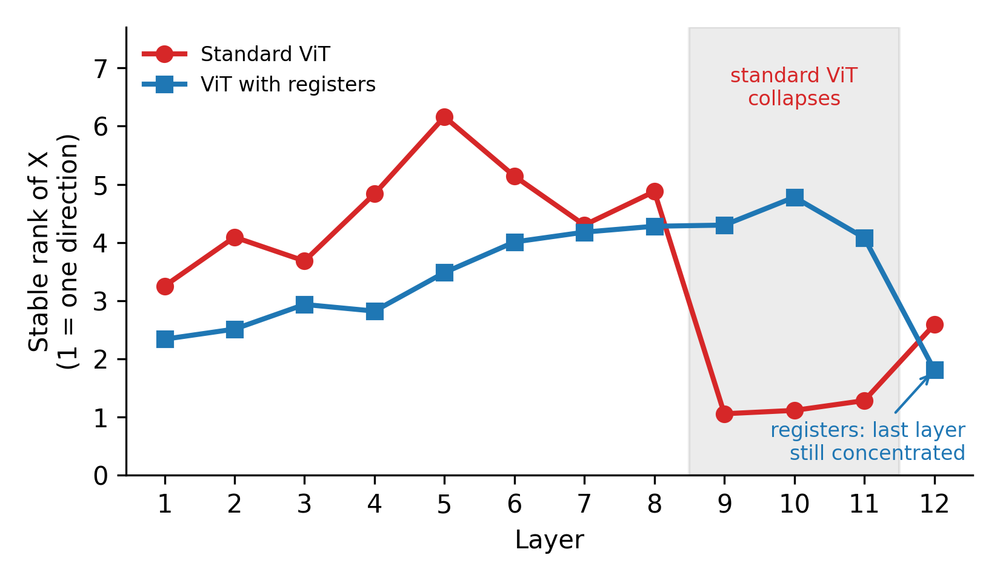

# asro-pilot
Pilot experiments for my MSCA Postdoctoral Fellowship 2027 proposal
(working title: ASRO – knowing when to correct spectral concentration in transformers).

## Question
Do the top singular directions of transformer token representations help, hurt,
or do nothing for the loss – and does this differ by layer?

## Status
- [x] v0: top-8 singular values per layer, DINOv2-base, 32 Imagenette val images
- [x] v0 diagnosis: outlier-token analysis + DINOv2-with-registers control
- [x] Randomised SVD check (Halko et al., 2011): layers 6 and 9, 32 images
- [ ] v1: exact loss change when damping each top-8 direction (~500 images)
- [ ] v2: pathology model on Camelyon17-WILDS
- [ ] v3: Pythia-160M / 410M

## First result

**Figure 1.** Stable rank of the token matrix per layer (DINOv2-base, 32 Imagenette
validation images; 1 = all energy in one direction).

- Layers 9–11 of the standard model collapse to stable rank 1.05–1.28: one direction
  carries about 95% of the energy. This is caused by ~3 high-norm patch tokens per image
  (21–53× the median norm); removing them restores stable rank 3.8–4.3.
- The model with registers (Darcet et al., ICLR 2024) shows no collapse, but its final
  layer stays concentrated (stable rank 1.81), along a direction shared by all tokens.
- So concentration has **at least two separate causes**: (1) a few high-norm outlier tokens
  and (2) a shared mean direction. Registers remove only the first.

Detailed two-panel version (incl. token-norm ratios):
[fig_prelim_concentration.png](results/asro_results/fig_prelim_concentration.png)

## Randomised SVD check
With 2 power iterations, randomised SVD (Halko et al., 2011) recovers the top-8 singular
values of the token matrices at layers 6 and 9 (32 images) within 1% of the exact SVD on
average (worst case 3.5%; 0.4% with 4 iterations), and the top direction almost exactly
(cosine ≥ 0.9999). Without power iterations the error is up to 38%. So ASRO uses k = 8, q = 2.

## All figures and data
Captions for every figure: [results/figure_captions.md](results/figure_captions.md)

| Figure | File | What it shows |
| --- | --- | --- |
| Figure 1 | [fig1_proposal_simple.png](results/asro_results/fig1_proposal_simple.png) | Stable rank per layer, standard ViT vs registers (proposal version) |
| Figure S1 | [fig_prelim_concentration.png](results/asro_results/fig_prelim_concentration.png) | Detailed version: stable rank (incl. outliers removed) and token-norm ratios |
| Figure S2 | [pilot_v0.png](results/asro_results/pilot_v0.png) | First pilot: top-8 singular values and top-1 energy share per layer |
| Figure S3 | [rsvd_study.png](results/asro_results/rsvd_study.png) | Randomised SVD error vs power iterations (layer 6, image 0) |
| Figure S4 | [sample_images.png](results/asro_results/sample_images.png) | Example input images |
| (draft) | [pilot_v0_registers_comparison.png](results/asro_results/pilot_v0_registers_comparison.png) | Early draft of Figure S1 (made by an earlier notebook version) |

| Data file | Contents |
| --- | --- |
| [pilot_v0_mean_singular_values.csv](results/asro_results/pilot_v0_mean_singular_values.csv) | Mean sigma_i / ‖H‖_F, 12 layers × top-8 |
| [pilot_v0_results.json](results/asro_results/pilot_v0_results.json) | Top-1 energy share and stable rank per layer |
| [pilot_v0_diagnostics.csv](results/asro_results/pilot_v0_diagnostics.csv) | Token-norm ratios and stable rank (raw, centred, no CLS, no outliers) per layer |
| [pilot_v0_registers_control.csv](results/asro_results/pilot_v0_registers_control.csv) | Same diagnostics for DINOv2-with-registers |
| [rsvd_study_per_image.csv](results/asro_results/rsvd_study_per_image.csv) | Randomised vs exact SVD per image (layers 6, 9; q = 0, 1, 2, 4) |
| [rsvd_study_summary.csv](results/asro_results/rsvd_study_summary.csv) | Summary: worst and mean error, minimum cos(v1) per layer and q |

## How to run
Open `notebooks/asro_pilot_v0.ipynb` in Google Colab (Runtime → T4 GPU) and run the cells in order:
Cells 1–5 = pilot v0, Cells 6 and 6b = randomised SVD study,
Cell 8 = outlier-token diagnosis, Cell 9 = registers control,
Cell 10b = detailed figure, Cell 10c = Figure 1, Cell 11 = zip all outputs.
Seed = 0. See `requirements.txt`. Progress notes: [evidence_log.md](evidence_log.md).

## Author
Dr Savitha K N (Mathematics; ML, AI, Transformers, RNN, CNN, Linear Algebra, Spectral Analysis, Optimisation)
